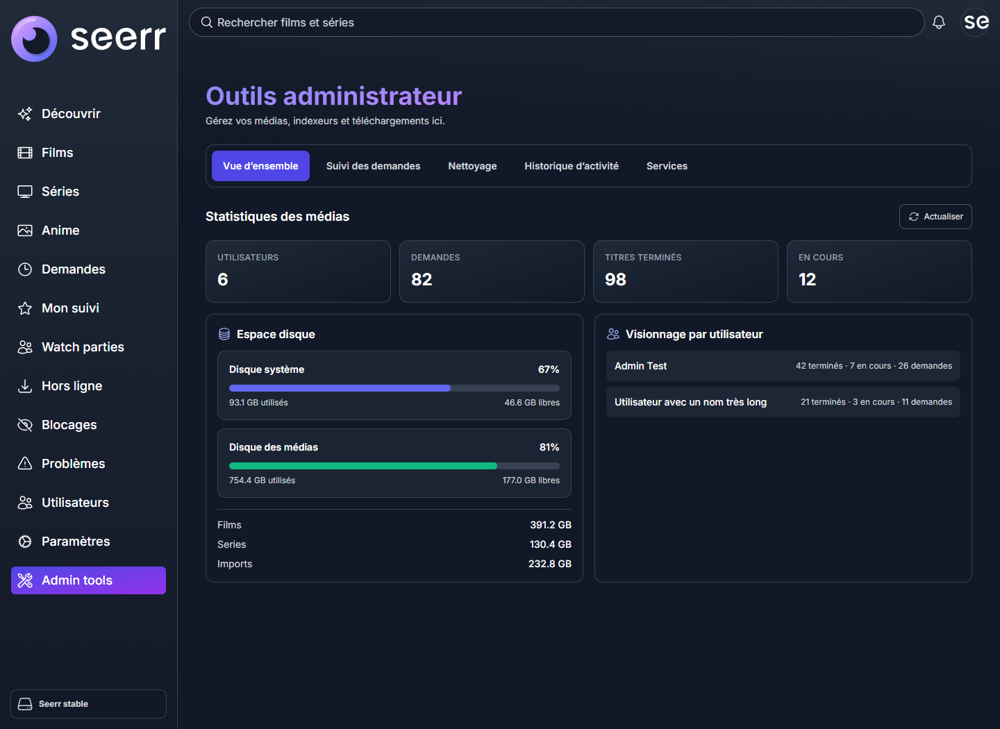
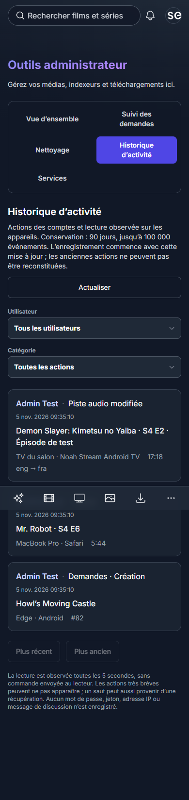

# Administration and activity history

The admin page separates overview, request monitoring, cleanup approvals, activity
history and embedded service tools. Only the selected panel mounts its content;
service iframes do not load while reviewing other sections.

## Layout previews

These screenshots use synthetic fixture data, not production user history.

Mobile activity history

## Activity history

Administrator-only `GET /api/v1/admin-tools/activity` supports `userId`, `category`,
`before` and `take` (1–100). Cursor pagination is stable while new events arrive.
Results are private and must not be cached. Ninety days and at most 100,000 events
are retained; cleanup runs opportunistically, at most hourly. Access requires the
normal Seerr admin permission. Passwords, tokens, cookies, IPs, chat messages and
raw request bodies/query strings are excluded. Do not expose the endpoint or DB
through the unauthenticated admin-service proxies.

The API middleware records request creation/approval/retry/removal, watchlist and
watch-history edits, cleanup decisions, account and settings changes, issues,
blocklist changes, and party mutations, including HTTP failure status. Resource
identifiers remain visible; this is not an immutable forensic ledger.

The playback observer reads existing Jellyfin sessions every five seconds,
associates them by Jellyfin account ID (never the account name), and records
playback detection/start/end, pauses/resumes, audio/subtitle switches and timeline
discontinuities with the device/client/title/position. It sends no playback
commands, creates no sessions and does not replace a player. Brief actions between
observations can be missed. Timeline changes may be recovery rather than deliberate
seeks. Existing playback at observer startup is labelled detected, not launched.
Network failures do not invent session ends; history displays observer availability.
This covers currently installed TV clients and casting without forcing an update.
Recording starts with installation; earlier individual controls cannot be rebuilt.
Activity write failures are rate-limited in logs and never block playback.

## Source cleanup countdown

The worker reports actual qBittorrent seeding state and remaining *active seeding*
time. The UI interpolates only fresh active-seeding reports, updates every 15s,
refreshes worker data every minute and freezes stale data after ten minutes.
Paused/missing-file/blocked states show the reason and verification timestamp.
A timer reaching zero is only presentation: the worker rechecks the real seeding
counter, exact approved files, current requests and active playback before deletion.
No countdown or history feature grants deletion authority.

## Request monitoring

All monitored rows can be expanded beyond the first twenty. Progress timestamps
and recovery budgets are visible, with stale/client-outage warnings. A private
tracker denial and unreachable trackers get distinct safe reason codes. Tracker
URLs, passkeys and raw error strings never enter public snapshots. Reads are
limited to four affected torrents per tick, cached for five minutes. Completed
Sonarr import conflicts whose expected episodes already have files are retained
as blocked replacement attempts, rather than overriding normal availability.
Active upgrades and missing episodes remain visible. These
conditions do not authorize deletion, repeated restarts or bypassing tracker access.

### Tracker account health

The request-monitor panel also displays the optional, administrator-only
`trackerHealth` snapshot. For budgeted accounts it shows verified allowance,
reserved bytes, pending reservations and the last verification time. Restrictions,
stale credit and profile-adapter setup errors remain separate; a generic access
denial is not automatically labelled quota exhaustion. Retry timestamps are the
earliest possible probe time, not a promise that a tracker will recover then.

The data is sanitized and bounded by `server/lib/requestPipeline.ts`. It is only
returned through the existing admin pipeline endpoint, with private/no-store
responses. Ordinary download-status enrichment does not include account balances.
There are English/French labels and responsive cards; the panel sends no tracker
commands and never spends Zen. A missing or stale monitor cannot block ordinary
Seerr reads or fabricate available credit.

The separate private Noah Stream deployment owns account verification, transactional
reservations, the local Prowlarr admission gateway and journaled fallback. Do not
put tracker keys into Seerr translations, frontend configuration or this repository.
The conservative full-torrent credit reservation is distinct from the 18 GiB
per-movie/per-episode media rule; it is not a total-season size restriction.

## Validation and deployment

Run the isolated activity DB/access/pagination tests, playback transition tests,
countdown freshness tests, request-monitor SSR tests, worker safety tests, both TS
checks and the production build. Apply the ActivityEvent entity registration and
the SQLite/PostgreSQL migration before enabling logging. Preserve the customized
runtime pairing, native playback-session and player source routes when overlaying
production. Do not replace production route files with an upstream-only build.
Back up SQLite and Compose first; test an isolated no-network candidate. Rollback
the app image only, preserving new history and subsequent user data.
