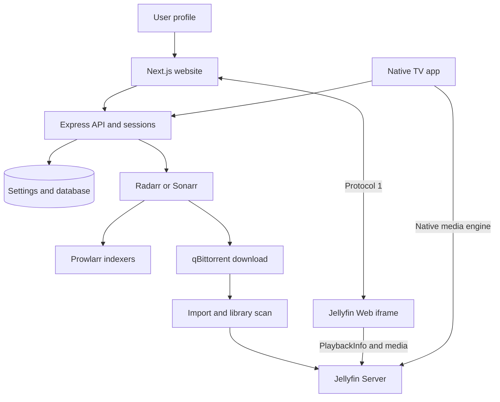

# Architecture

[Documentation](README.md) · [Playback](playback.md)

## Request and playback paths

Mermaid diagram definition

Seerr manages catalog/request state; availability must reflect imported library
files. Torrent progress reaching 100% is not the same as a successful import and
Jellyfin scan. Jellyfin returns sources and playback decisions; client capability
and subtitle selection determine Direct Play, remuxing or transcoding.

## Code map

| Area | Entry point |
| --- | --- |
| Embedded play UI | [PlayButton](https://github.com/Noah13s/noah-seerr/blob/main/src/components/Common/PlayButton/index.tsx) |
| Versioned player endpoint | [playerBridge.ts](https://github.com/Noah13s/noah-seerr/blob/main/src/utils/playerBridge.ts) |
| Session preparation | [jellyfinSession.ts](https://github.com/Noah13s/noah-seerr/blob/main/src/utils/jellyfinSession.ts), [auth routes](https://github.com/Noah13s/noah-seerr/blob/main/server/routes/auth.ts) |
| Resume and rewatch | [viewingResume.ts](https://github.com/Noah13s/noah-seerr/blob/main/server/lib/viewingResume.ts), [watch history](https://github.com/Noah13s/noah-seerr/blob/main/src/components/WatchHistory/index.tsx) |
| Continue Watching | [slider](https://github.com/Noah13s/noah-seerr/blob/main/src/components/Discover/ContinueWatching/index.tsx) |
| Casting controls | [CastingContext](https://github.com/Noah13s/noah-seerr/blob/main/src/context/CastingContext.tsx), [Casting UI](https://github.com/Noah13s/noah-seerr/blob/main/src/components/Common/Casting/index.tsx) |
| Offline media | [offlineMedia.ts](https://github.com/Noah13s/noah-seerr/blob/main/src/utils/offlineMedia.ts), [offline page](https://github.com/Noah13s/noah-seerr/blob/main/src/pages/offline.tsx) |
| Pairing | [DevicePairing](https://github.com/Noah13s/noah-seerr/tree/main/src/components/DevicePairing), [pairing routes](https://github.com/Noah13s/noah-seerr/blob/main/server/lib/device-pairing/pairing-routes.cjs) |
| Administrative review | [cleanupReviews.ts](https://github.com/Noah13s/noah-seerr/blob/main/server/routes/cleanupReviews.ts), [AdminCleanupReview](https://github.com/Noah13s/noah-seerr/blob/main/src/components/AdminCleanupReview.tsx) |

## Runtime boundary

The reviewed production image includes maintained backend runtime components.
The auth source requires `server/lib/native-playback-session.cjs`; that helper is
maintained in the private integration repo rather than tracked here. Current
custom CI checks the client and bridge, not full compiled-server parity.
See [installation](installation.md) and [deployment](deployment.md) before using
the root Dockerfile as a replacement for production.

Sessions and preferences belong to the signed-in profile. A browser player's
first-frame event drives the host out of loading state. History is Seerr-owned;
Jellyfin's played flags are not a replacement for its rewatch/resume model.
