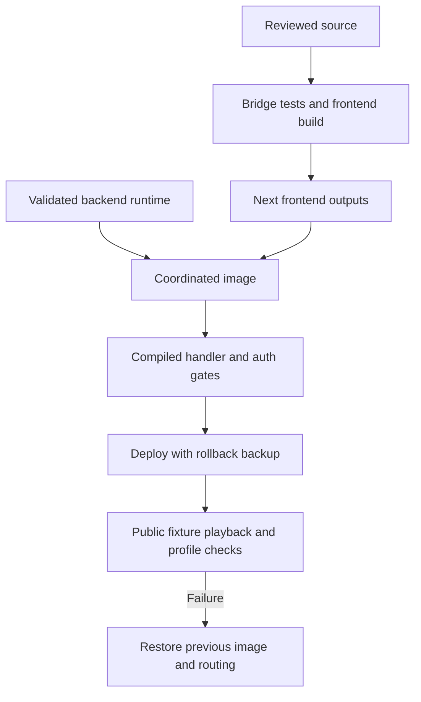

# Deployment and updates

[Documentation](README.md) · [Installation](installation.md) · [Troubleshooting](troubleshooting.md)

## Current release model

Production combines a reviewed custom backend runtime with the built Next
frontend. The private integration repository records exact source IDs, image
digests, player inventory and rollback paths. Its source-player Dockerfile copies
frontend outputs into the validated prior runtime and checks auth parity.

The root upstream Dockerfile builds the server too. Using it does not establish
parity with that deployed runtime, especially while private runtime dependencies
remain outside this public checkout. Full-backend replacement is a separate
migration with explicit handler/authentication tests.

Mermaid diagram definition

## Release requirements

1. Review source scope and obtain approval for version-control/release changes.
2. Pass `bridge-and-build`; verify compiled handlers when runtime files change.
3. Record image/source IDs and pair player bridge protocol versions.
4. Back up active routing/configuration and take a consistent database snapshot.
5. Validate anonymous rejection and actual non-admin browser/native identity,
   token reuse/revocation, profile switching and logout isolation.
6. Check catalog/API health, play/resume, seek, subtitles and old-client assets
   through the public host. Preserve user history during tests.

For a **Jellyfin Web-only** update, retain the Seerr image and do not restart it.
The integration helper switches the player alias and retains old chunks. It
waits for the expected manifest after Nginx's asynchronous reload.

## Upstream update policy

The reviewed upstream base is Seerr **v3.5.0**. GitHub may compare this fork
with upstream `develop`, which includes unreleased work. Choose a stable tag
deliberately and preserve its ancestry on a review branch.

Review custom auth routes, history/rewatch, availability/deletion state, pairing,
cleanup and the source-player bridge. Run frontend and backend-specific gates;
do not infer backend correctness from `build:next`. Review lockfile, migrations,
service API changes and the native app's consumption of profile settings.

## Rollback

Restore the previous image and active routing from the release record, then
verify authenticated playback. For frontend-only failures, do not restore an
old database over new user activity. Database migrations need their own reviewed
recovery plan. Keep tokens, databases and operator runbooks out of this public repo.
