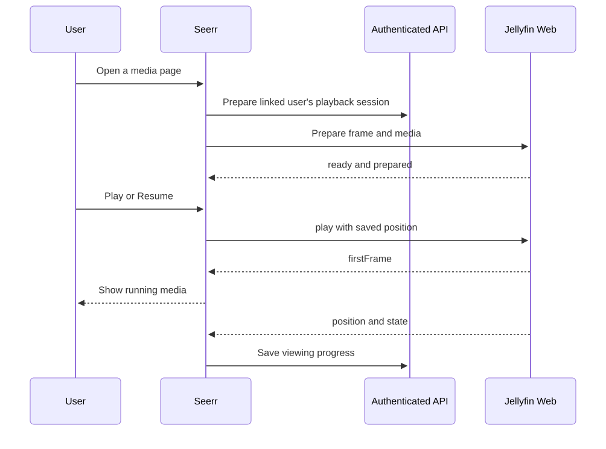
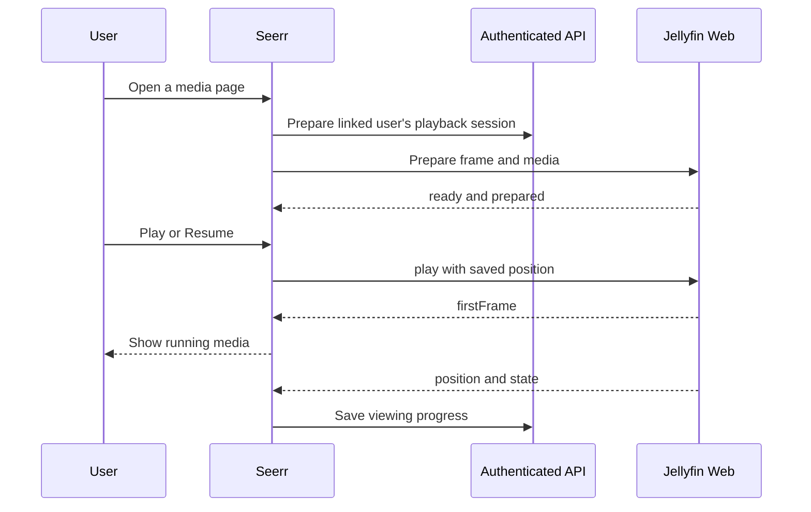

# Playback and user features

[Documentation](README.md) · [Architecture](architecture.md) · [Troubleshooting](troubleshooting.md)

## From Play to first frame

Mermaid diagram definition

The host uses [PlayerBridge](https://github.com/Noah13s/noah-seerr/blob/main/src/utils/playerBridge.ts), rather than
inspecting the player's iframe DOM. Both endpoints validate origin, window,
protocol version and frame identity. PlaybackInfo and capability decisions stay
with Jellyfin/player source. Browser/native session channels are isolated.

## Profile behavior

| Feature | Expected behavior |
| --- | --- |
| Continue Watching for series/anime | Navigate to the relevant expanded season/highlighted episode; play there |
| Rewatch a completed episode | Preserve the watched record while saving the new viewing position |
| Episode watched override | Mark watched/unwatched explicitly without relying only on Jellyfin flags |
| Ratings | Personal star rating belongs to the signed-in profile |
| Anime disabled | Hide anime navigation/sliders and gate their feeds for that profile |
| Device pairing | Approve the displayed QR/code from the logged-in profile; confirmation creates a separate device session |
| Cast | Seerr remains the remote; receiver playback can outlive the browser tab |
| Watch party | Signed-in users create a party; the host administers it and guests join through its invitation flow |
| Offline library | Browser/device capability determines local storage and playback support |

Offline media is not a universal VLC implementation. Browser storage, device
filesystem access and codec support vary; do not promise permanent arbitrary
folder access on every platform. The native TV app has its own playback engine.

## Administrative features

Administrative tools depend on permissions and protected backend endpoints.
Cleanup proposals must be reviewed; media deletion approval is distinct from
temporary transcode/cache maintenance. Required tracker seeding can defer final
payload removal. Preserve request/history ownership so deleted titles can be
requested again. Runtime operations are documented in the private integration repo.
