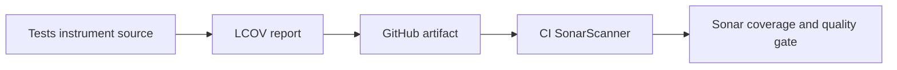

# Runtime reliability, security and coverage

Local implementation batch, 26 October 2026. The starting default-branch Sonar
snapshot has 183 Seerr findings. The finding ledger records targets for fresh
analysis, not confirmed closures. No online dispositions have been changed.

## Request and account failures

Approve/decline actions own their promises and reject duplicate clicks while
changes are pending. A batch waits for every request, refreshes the resulting
state even after partial failure, and shows the existing localized error toast.
Modal completion owns refresh failures too. Linked-account deletion/revalidation
and link-modal refresh errors stay in the settings UI instead of becoming
unhandled rejections.

Notification agents remain independent background deliveries. Each agent owns
both synchronous exceptions and rejected deliveries; failure is logged without
preventing other agents or making a committed request appear to fail. This does
not introduce persistent notification retries or change delivery guarantees.

The infinite-scroll hook installs one listener/debouncer per mount, reads current
props and cancels both pending timers when unmounted. Scroll-state rerenders
no longer replace listeners or reset the debounce.

## Dependency installation

The ARM image build installs its compiler prerequisites with APK, then uses the
project's already pinned `node-gyp` dependency through the frozen pnpm lockfile.
The redundant unpinned global npm install is removed. Native lifecycle scripts
required by SQLite/bcrypt/sharp remain governed by `pnpm.onlyBuiltDependencies`.
This batch has not executed an ARM container build; the hosted production-image
smoke remains a required check.

## Why Sonar did not show coverage

SonarQube Cloud does not execute tests or calculate their coverage. Its automatic
analysis cannot import coverage; a CI scanner must run after the report exists.
See [Sonar's coverage guide](https://docs.sonarsource.com/sonarqube-cloud/analyzing-source-code/test-coverage/overview).

The runner creates report directories, fails on report-write errors, supports
both existing coverage flags and excludes test files from the production
coverage calculation. CI retains JUnit and LCOV for 14 days.

Use `pnpm test:coverage` for source-level coverage. It runs the same test suite
through pinned c8, which remaps V8 ranges through ts-node's inline source maps.
The native `node:test` LCOV reporter reports transpiled locations with this
loader: the first CI import reported 336 line inconsistencies and a function
at generated line 1 instead of source line 2. That report's earlier percentages
must not be used as an accurate TypeScript coverage baseline. The native flags
remain available for diagnostics, but CI imports the remapped `coverage/lcov.info`.

c8 reports the production modules loaded by the tests. Sonar independently
includes untested production files in its denominator, so its overall coverage
will differ from the local report. Tests do not cover every UI component.
Regression tests check original function locations, source-line bounds, test
exclusions and failure exit status. The generated root JUnit `report.xml` is an
analysis artifact, not source code.

The corrected local run passes all 294 tests plus two reporting regressions.
Its LCOV has 158 loaded production files, including the CommonJS playback bridge,
no out-of-bounds line/function/branch
locations and no test files. It reports 48.06% line coverage of those loaded files;
this is not Sonar's whole-repository percentage or a claim of complete UI tests.

Reporter paths are limited to the fixed CI `report.xml`, the checkout's
`coverage/` directory or the system temporary directory, with report extensions.
Source-tree destinations, parent/output symlinks and existing hard links are
rejected before the test harness starts. A real-entrypoint regression verifies
that a refused destination creates no directory and produces an actionable error.

### Activate CI analysis after reviewing and merging the workflow

All three repositories have a `sonar` job and `sonar-project.properties`.
The jobs run when repository variable `SONAR_CI_ENABLED` is `true`.
Automatic Analysis and CI analysis must not compete during migration.

On 26 October 2026 the owner approved activating CI analysis in all three
projects. The repository secrets and variables are remote settings; their token
values must never be recorded here. Use the following steps for a new project or
when recovering a missing configuration.

1. Add a project-scoped analysis token as repository secret `SONAR_TOKEN`. Never
   place a token in source, a command argument, an artifact or a screenshot.
2. In each Sonar project, open Administration → Analysis Method and disable
   Automatic Analysis.
3. Set GitHub repository variable `SONAR_CI_ENABLED=true` and dispatch its normal
   workflow. Check the analyzed revision, coverage-import log and quality gate.
4. Enable the new job as a required check only after its first successful scan.

The jobs fetch full history, require nonempty reports, exclude fork PRs from
token-bearing scans and wait for Sonar's quality gate. They use normal
`pull_request`, never `pull_request_target`. Tests and coverage artifacts still
run on fork PRs. On a failed migration, disable the variable and restore Automatic
Analysis until the scanner problem is resolved.

An imported coverage report can make a previously green gate fail: the existing
80% new-code requirement is now evaluated instead of having no coverage data.
Fix missing tests rather than lowering that requirement, excluding untested
production code or advancing the new-code baseline merely to turn the gate green.

For Jellyfin Web the reports cover Vitest plus its independent Node casting
contracts. For Stream the scanner receives Flutter LCOV normalized to repository
paths plus compiled Android Java classes; Dart support also requires an eligible
Sonar plan for the private project. Host-test coverage is not native decoder or
physical-device coverage. Existing migrations remain in source analysis; only
their historical execution is excluded from unit-test coverage.

## Validation and remaining work

294 backend/client utility tests, five runner metatests, the final hook regression,
client/server typechecks, changed TypeScript ESLint and production server/Next
builds passed locally. Hosted container/browser gates and a fresh Sonar scan of
an approved commit remain necessary. No production deployment was performed.

Remaining work includes subscriber/entity and other screen promise paths,
active detail/request UI duplication, case-specific contextual security reviews,
and accessibility/localization debt. The green gate does not mean this backlog
is resolved. Never rewrite applied migrations merely to lower duplication.
